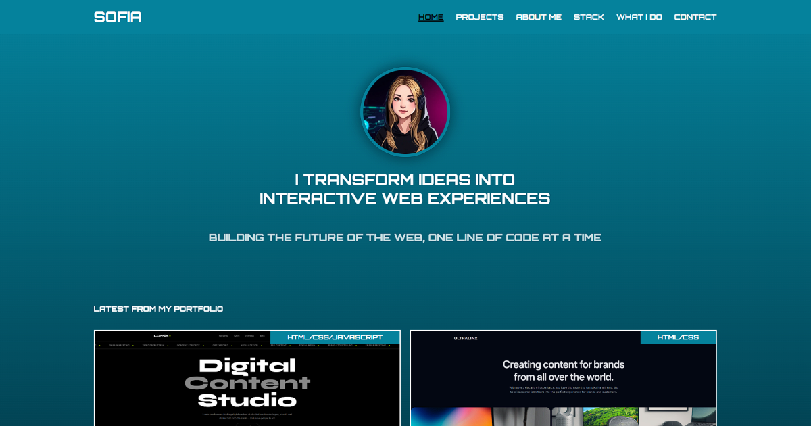

# Sofia Vieira | Frontend Developer Portfolio
 
Welcome to my personal portfolio website! This project showcases my work, skills, and journey as a Frontend Developer.

The portfolio highlights my projects, technical skills, and approach to web development. It also provides a way for potential clients, recruiters, and companies to connect with me about freelance projects, collaborations, or employment opportunities.

Live site: [bysofiadev.vercel.app](https://bysofiadev.vercel.app)
 
## About
 
This portfolio website was built to showcase my frontend development projects and demonstrate my ability to create clean, responsive, and user-friendly websites.

It is a two-page static site:
 
- `index.html`: hero, latest projects, about me, skills, and contact
- `allprojects.html`: the full list of projects

## Preview



## Features
 
- Responsive, mobile-first layout with fluid typography (`clamp()`)
- Slide-in mobile navigation menu that closes when a link is clicked
- Sections revealed on scroll with `IntersectionObserver`
- Active menu link highlighted according to the visible section (scroll spy)
- Hover effects on project, skill and contact cards
- Respects `prefers-reduced-motion`
- Semantic HTML (`header`, `main`, `section`, `footer`, `nav`)
- Meta description, Open Graph and Twitter Card tags for link previews
- Design tokens (colors, gradients, font weights) as CSS custom properties

## Built with
 
- HTML5
- CSS3 
- Vanilla JavaScript 

## Project structure
 
```
portfolio-website/
├── index.html
├── allprojects.html
├── assets/
│   └── images/
│       ├── apple-icon.png
│       ├── avatar.png
│       ├── favicon.ico
│       ├── hero-section.png
│       ├── project-lumio-studio.png
│       └── project-ultralinx.png
├── css/
│   ├── _variables.css
│   └── main.css
├── js/
│   └── main.js       
├── LICENSE
├── README.md
└── preview.png 
```
 
- `css/_variables.css` holds the design tokens and is imported by `css/main.css`.
- `js/main.js` handles the mobile menu, scroll reveal, scroll spy and the footer year.

## Run locally
 
No installation needed.
 
1. Clone the repository:
```bash
   git clone https://github.com/bysofiadev/portfolio-website.git
```
2. Open the folder in VS Code.
3. Start it with the **Live Server** extension, or simply open `index.html` in your browser.

## Deployment
 
The site is configured as a static website, with index.html at the root of the repository.
 
## Licence

The source code in this repository is licensed under the MIT License. You are welcome to explore, reuse, and modify the code in accordance with the terms of the license.

The MIT License applies to the source code only. Original portfolio content, including personal text, photography, branding, and visual identity, is reserved and is not licensed for reuse under the MIT License.

Please do not reproduce or present my original portfolio content as your own work without permission.

Third-party assets and dependencies remain subject to their respective licenses.

See the LICENSE file for the full MIT License.

## Author

Sofia Vieira

Built as part of my frontend learning journey.

## Contact
 
- GitHub: [@bysofiadev](https://github.com/bysofiadev)
- LinkedIn: [linkedin.com/in/bysofiadev](https://www.linkedin.com/in/bysofiadev)

&copy; 2026 Sofia Vieira. All rights reserved.


